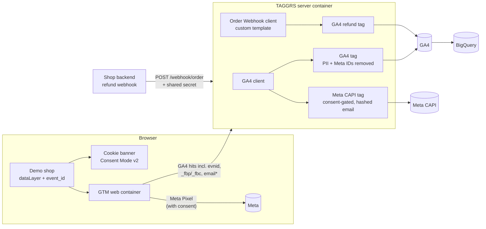

# Server-Side Tracking Implementation & QA Framework


End-to-end **server-side tracking** for a demo e-commerce shop ("Coffee House"), built the way a
client onboarding would be done: tracking plan → dataLayer → GTM web container → **TAGGRS-hosted
server container** → GA4 and Meta Conversions API, with Consent Mode v2, PII controls, a custom
webhook client and an automated QA suite.

**Live shop:** https://gaurav-1410.github.io/server-side-tracking/ (demo only – use test data)

---

## Why server-side tracking

Ad blockers, Safari ITP and consent rules cut browser-side data. Routing tracking through a
first-party tagging server gives back control: one event stream in, a cleaned and consent-checked
copy out to each vendor, and personal data handled on infrastructure you control.

## Architecture


\* email only with marketing consent; hashed (SHA-256) on the server before it reaches Meta.

## What is tracked

Derived from 7 business questions (`docs/tracking-plan/`). Every event exists because a KPI needs it.

| Event | Business question | GA4 | Meta | Source |
|---|---|---|---|---|
| view_item_list, select_item | discovery, A/B clicks | ✓ | – | browser → server |
| view_item, add_to_cart, begin_checkout, add_payment_info | funnel, product performance | ✓ | ✓ (Pixel + CAPI, deduplicated) | browser → server |
| add_shipping_info | funnel | ✓ | – | browser → server |
| purchase | revenue, attribution, data quality | ✓ | ✓ (Pixel + CAPI, deduplicated) | browser → server |
| generate_lead | newsletter → buyer | ✓ | ✓ Lead (Pixel + CAPI) | browser → server |
| experiment_impression | A/B test "Customers also bought" | ✓ | – | browser → server |
| refund | net revenue | ✓ | – | **backend webhook → server** |

## Privacy and consent design

| Consent choice | GA4 | Meta Pixel | Meta CAPI | user_id | email |
|---|---|---|---|---|---|
| Reject all | cookieless pings only (`gcs=G100`) | blocked | blocked (server checks `gcs`) | not sent | not sent |
| Analytics only | full (`G101`) | blocked | blocked | sent | not sent |
| Accept all | full (`G111`) | ✓ | ✓ | sent | hashed, Meta only |

- Consent Mode v2 defaults to **denied** before GTM loads; open-source CMP (CookieConsent v3) with a footer link to change consent.
- Consent is enforced **twice**: in the browser (GTM consent settings) and on the server (CAPI trigger requires `gcs` = `G11…`).
- **Transformation** in the server container removes `x-fb-ud-em`, `x-fb-ck-fbp`, `x-fb-ck-fbc` from the GA4 tag only – one incoming event, different data per destination.
- Meta automatic events and automatic advanced matching disabled: only events from the tracking plan are sent.

## Engineering highlights

- **Deduplication:** one `event_id` per event in the dataLayer → Meta Pixel `eventID` and server CAPI `event_id`. Verified pair-by-pair in Meta Test Events.
- **Custom sGTM client** (`gtm/templates/webhook-client.js`): sandboxed JavaScript, shared-secret auth, payload validation, 200/400/401/405 responses, least-privilege permissions, idempotent `event_id`. Spec: `docs/webhook-spec.md`.
- **Automated QA** (`tests/`, Playwright + pytest, GitHub Actions on push and daily): 8 dataLayer contract tests + 4 tests on what actually reaches the tagging server and Meta per consent state.
- **Warehouse validation:** GA4 → BigQuery export; SQL for net revenue after refunds and purchase reconciliation (`sql/`).

## Findings from debugging (selection – full log in `docs/debug-log.md`)

1. **Privacy bug found in BigQuery:** `user_id` was still sent after "Reject all" (GA4 strips its cookie ID, not custom IDs) – declined sessions could be re-identified. Fixed with a consent-aware GTM variable; now covered by an automated test.
2. **"No tags were evaluated"** in server Preview while DebugView was empty: events reached the server but the GA4 forwarding tag was missing from the previewed version.
3. **Unplanned `SubscribedButtonClick`** events spotted in the Network tab: Meta's automatic events, disabled.
4. **Automated tests initially saw no Meta and few GA4 events:** the Meta Pixel drops traffic from browsers flagged as automated, and the Google tag sends server-side hits through a **service worker** (`/_/service_worker/…/sw_iframe.html`) that Playwright doesn't observe. Fixed in the test browser setup; the Google tag sends `event_id` as **`evnid`**.

## Repository structure

```
shop/                 demo shop (GitHub Pages) – tracking.js holds all dataLayer logic
gtm/                  container exports (secrets redacted) + custom client template
webhook/              backend simulator for refund webhooks
tests/                Playwright QA suite (+ debug_requests.py diagnostic)
sql/                  BigQuery: net revenue, reconciliation, funnel
docs/                 tracking plan, implementation guide, debug runbook, QA checklist, webhook spec, debug log
scripts/              redact_gtm_export.py
```

## Run it yourself

```bash
uv sync                                   # or: pip install -r tests/requirements.txt
python -m playwright install chromium
export TAGGRS_HOST=<your tagging server host>
cd tests && python -m pytest -v
```

## What I would add for a real client

- **Custom tracking subdomain** (e.g. `sst.coffeehouse.de` via DNS) so the server shares the shop's cookies – better Meta match quality and longer cookie lifetime under ITP.
- Google Ads conversions + Enhanced Conversions; TikTok Events API (same pattern as Meta).
- Monitoring alerts on event volume drops (BigQuery scheduled query or TAGGRS dashboard).
- Consent strategy review with the DPO (Advanced vs. Basic Consent Mode).

## Stack

Google Tag Manager (web + server) · TAGGRS · GA4 · BigQuery · Meta Pixel & Conversions API ·
CookieConsent v3 · Playwright · pytest · GitHub Actions · GitHub Pages · Python (uv)
